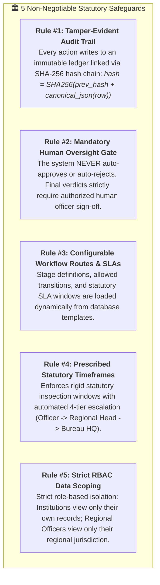
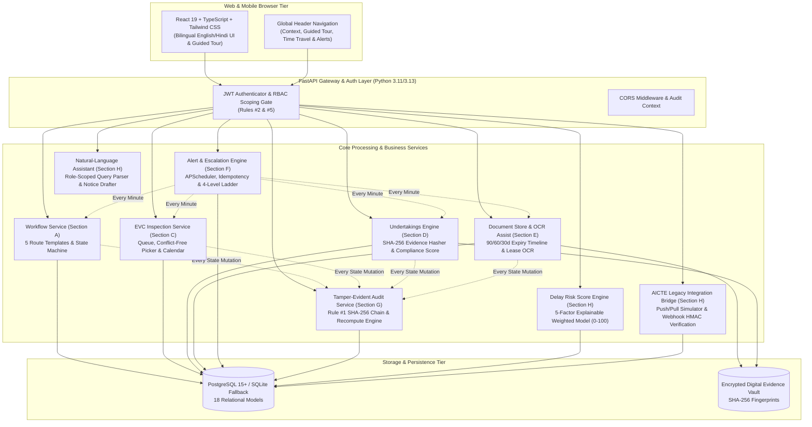

# 🏛️ IntelliApprove
### AICTE Approval Workflow Automation, Statutory Compliance & Vigilance Engine
**Smart India Hackathon (SIH) 2026 — Problem Statement 26262**  
*All India Council for Technical Education (AICTE), Ministry of Education, Government of India*

[](file:///d:/IntelliApprove/backend/tests)
[](file:///d:/IntelliApprove/frontend)
[](file:///d:/IntelliApprove/backend/app/services/audit_service.py)
[](file:///d:/IntelliApprove/backend/app/services/workflow_service.py)
[](LICENSE)

---

## 📌 Executive Summary

Every year, over 10,000+ technical institutions across India apply to the **All India Council for Technical Education (AICTE)** for Extension of Approval (EoA), establishment of new institutions, intake variations, and program additions.

Historically, manual handoffs, opaque dwell times, paper-based inspection queues, and delayed deficiency rectifications have caused substantial administrative overhead and potential governance vulnerabilities.

**IntelliApprove** is a resilient, modern, government-grade workflow automation platform engineered specifically for AICTE. It provides:
1. **Dynamic Approval Workflow Engine**: 5 configurable approval templates, state-machine transitions, and mandatory-reason reverts.
2. **Real-Time Role-Based Dashboards**: Real-time Recharts visualizations (ageing buckets, dwell-time bottlenecks, officer workloads, and national regional heatmaps).
3. **Automated EVC Inspection Management**: Conflict-free committee scheduling, month-view inspection calendar, and priority queue for new institutions.
4. **Conditional Undertakings & Compliance Engine**: Evidence tracking with SHA-256 cryptographic hashing and automated institution compliance scoring.
5. **Lease & Document Validity Monitoring**: Expiry timeline tracking with 90/60/30-day thresholds and Lease OCR Assist pre-fill.
6. **Statutory Alert & 4-Tier Escalation Ladder**: Background APScheduler worker, multi-channel notification dispatchers, and simulated time-travel clock.
7. **Tamper-Evident SHA-256 Audit Trail**: Genesis-anchored cryptographic ledger with instant chain integrity verification and 6 statutory exportable reports.
8. **Differentiating Capabilities**: Explainable Delay Risk Score, Natural-Language Statutory Assistant, Lease OCR scan, and AICTE Portal Integration Bridge.

---

## 🛡️ The 5 Non-Negotiable Regulatory Safeguards

To preserve statutory integrity, regulatory transparency, and vigilance compliance, IntelliApprove strictly enforces five immutable architectural rules:



---

## 🏗️ System Architecture



---

## 🧰 Tech Stack

| Layer | Technology | Key Capabilities & Packages |
| :--- | :--- | :--- |
| **Backend API** | **Python 3.11 / 3.13 + FastAPI** | High-performance asynchronous REST API, OpenAPI/Swagger interactive docs, Pydantic v2 strict data schemas. |
| **Persistence & ORM** | **SQLAlchemy 2.0 + Alembic** | Database-agnostic relational ORM supporting PostgreSQL (Supabase, Neon, Render) with SQLite local dev fallback. |
| **Background Scheduler** | **APScheduler 3.10** | Concurrent background worker running statutory SLA monitors, alert rule evaluations, and multi-tier escalations. |
| **Security & Auditing** | **Python-Jose + Passlib + Cryptography** | JWT Bearer tokens, salted bcrypt hashing, HMAC SHA-256 webhook signatures, Merkle-lineage hash chaining. |
| **Frontend Framework** | **React 19 + TypeScript 5.8** | Modern reactive component architecture, strict typing, Zero layout shift (CLS < 0.05). |
| **Bundler & Tooling** | **Vite 8.3 + Tailwind CSS v4** | Instant Hot Module Replacement (HMR), sub-2-second production compilation (`tsc -b && vite build` in 1.39s). |
| **Data Visualizations** | **Recharts 3.10** | Interactive SVG charts (stage funnel, ageing buckets, regional dwell time, officer workload). |
| **Automated Testing** | **Pytest + Playwright Chrome** | 107 unit/integration tests passing (100%), automated headless browser walkthrough with zero console errors. |

---

## 🚀 Quickstart: Local Development Setup

### Prerequisites
- **Python 3.11+**
- **Node.js 18+ & npm**
- **Google Chrome** (for Playwright automated verification)

### 1. Clone & Set Up Backend
```bash
# Clone the repository
git clone https://github.com/your-org/IntelliApprove.git
cd IntelliApprove

# Create virtual environment
python -m venv venv

# Activate virtual environment
# Windows (PowerShell):
.\venv\Scripts\Activate.ps1
# Linux / macOS:
source venv/bin/activate

# Install backend dependencies
pip install -r backend/requirements.txt

# Run one-step clean seed and cryptographic chain verification
python seed_reset.py

# Launch FastAPI backend server
cd backend
uvicorn app.main:app --host 127.0.0.1 --port 8000 --reload
```
*Backend API will run at `http://127.0.0.1:8000` with interactive Swagger docs at `http://127.0.0.1:8000/docs`.*

### 2. Set Up & Launch Frontend
```bash
# In a new terminal window
cd frontend

# Install dependencies
npm install

# Build to verify production readiness
npm run build

# Start Vite development server
npm run dev
```
*Frontend portal will run at `http://127.0.0.1:5173`.*

---

## 🔑 Pre-Configured Demo Accounts (All 6 Roles)

Default password for all demo accounts: **`aicte123`**

| Role Persona | Demo Email | Jurisdiction / Scope | Key Operational Capabilities |
| :--- | :--- | :--- | :--- |
| **ADMIN** | `admin@aicte.gov.in` | National HQ (All Regions) | System clock time travel, one-click demo reset, audit verification, user management. |
| **BUREAU_OFFICER** | `member.secretary@aicte.gov.in` | Approval Bureau (HQ) | Rule #2 human approval/refusal authority gate, speaking orders, policy oversight. |
| **REGIONAL_HEAD** | `head.nw@aicte.gov.in` | North-Western Region | Regional team workload, Level-2 SLA escalations, SAC/SHC committee appointments. |
| **REGIONAL_OFFICER** | `ro.w@aicte.gov.in` | Western Region | Scrutiny review, deficiency return with mandatory remarks, undertaking verification. |
| **EVC_MEMBER** | `evc.expert1@aicte.gov.in` | Eastern Region (Field) | Assigned physical/virtual EVC inspection visits, field report uploads. |
| **INSTITUTION** | `principal@ditm.ac.in` | Delhi Institute of Tech. | Submit EoA applications, upload renewal deeds, rectify shortfalls, track compliance score. |

---

## 🔄 One-Step Clean Demo Data Reseed & Reset

To restore clean evaluation data across all models with exactly 20 institutions, 94 applications, and re-verify the Rule #1 SHA-256 audit ledger in a single step (runs in < 10 seconds):

```bash
# Reseed via backend seed script with --reset
python backend/app/seed.py --reset

# Or via root convenience runner
python seed_reset.py

# Or platform shell scripts
# Windows:
seed-reset.bat
# Linux / macOS:
./seed-reset.sh
# Frontend npm script:
npm run seed:reset
```

### 📊 Seed Dataset Volume & Distribution Summary
- **20 Institutions**: Across all 8 AICTE regions (4 regions with 3 institutions, 4 regions with 2). Realistic Indian names covering Engineering, Polytechnic, Management, Pharmacy, and Architecture, with exactly 6 marked `is_new = True`.
- **94 Applications**: Every institution has between 3 and 8 applications. Delhi Institute of Technology & Management (`principal@ditm.ac.in`) has **exactly 8** applications.
- **Workflow Routes**: Only Scrutiny (19), Scrutiny + EVC (33), EVC + SAC/SHC (14), Only EVC (9), Scrutiny + EVC + SAC/SHC (19).
- **Workflow Stages**: Submission (8), Scrutiny (26), EVC (22), SAC/SHC (13), Bureau decision (7), Approved (11), Refused (4), Returned for clarification (3).
- **Active Cases Ageing**: 0–7 days (19), 8–15 days (19), 16–30 days (23), 30+ days (15).
- **SLA Deadlines**: 14 overdue, 9 due within 7 days (approaching deadline in 1–3 days), and 7 returned at least once with recorded speaking reasons.
- **Related Records**: 15 EVC schedules (3 queued, 3 scheduled, 3 due soon, 3 overdue, 3 completed), 30 undertakings across 5 statuses, 40 documents (3 expired, 4 in 30d, 6 in 90d, 27 long-term valid, 3 renewals), 15 notifications, 6 escalations, and validated SHA-256 audit ledger.

*In cloud environments (Vercel/Render), administrators can also trigger a reset via `POST /api/v1/admin/reset-demo-data`.*

---

## 📚 Documentation & Evaluator Guides

- 📖 **[5-Minute Evaluator Live Demo Script](file:///d:/IntelliApprove/docs/demo-script.md)**: Timed, step-by-step walkthrough covering submission, deficiency return, time travel, and audit verification.
- 🗺️ **[Statutory Requirement & Feature Matrix](file:///d:/IntelliApprove/docs/feature-matrix.md)**: Traceability matrix mapping Sections A through H to exact APIs and UI components.
- 🚀 **[Cloud Deployment Guide](file:///d:/IntelliApprove/docs/deployment.md)**: Production deployment instructions for Vercel, Netlify, Render, Railway, Supabase, and Neon.
- 🔒 **[Security & Vigilance Architecture](file:///d:/IntelliApprove/docs/security.md)**: Deep dive into Rule #1 cryptographic hash chaining, digital signatures, and RBAC scoping.
- 📊 **[Comprehensive QA Verification Report](file:///d:/IntelliApprove/FINAL_QA_AUDIT_REPORT.md)**: Performance benchmarks (< 600ms load), test coverage (107/107 passed), and 21 captured screenshot artifacts.
