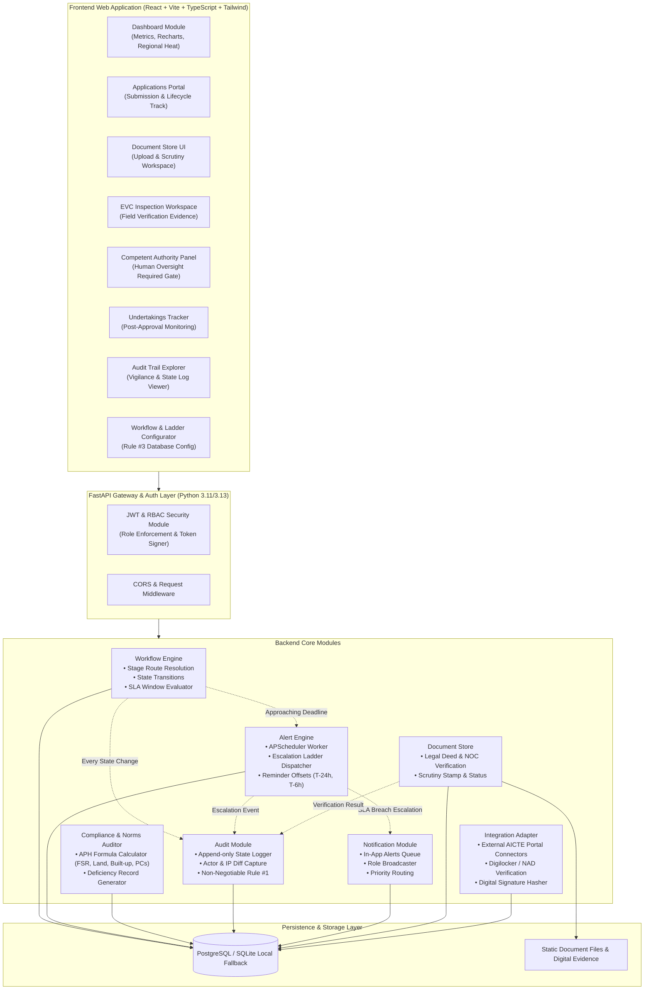
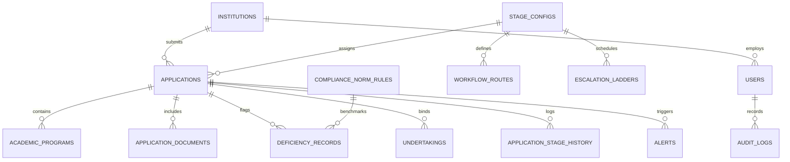

# IntelliApprove: System Architecture Specification
**AICTE Approval Workflow Automation, Compliance Monitoring and Alert Management System**  
**SIH 2026 — Problem Statement 26262**

---

## 1. High-Level Modular Architecture

---

## 2. Core Modules Breakdown

### 1. Workflow Engine
- **Purpose**: Governs the application lifecycle from DRAFT through SCRUTINY, EVC, HEARING, and COMPETENT AUTHORITY DECISION.
- **Rule #3 Dynamic Compliance**: Reads valid transitions exclusively from the `workflow_routes` and `stage_configs` database tables, preventing hardcoded business logic.
- **Rule #2 Human Oversight Gate**: Enforces that automated engines cannot advance an application directly into APPROVED or REJECTED. Only an authenticated human user with role `COMPETENT_AUTHORITY` can sign the final verdict.

### 2. Alert Engine
- **Purpose**: Background daemon (powered by APScheduler) monitoring stage timeouts and pending deadlines.
- **Escalation Ladders**: Reads configurable `escalation_ladders` per stage.
  - Generates warning notifications at configured reminder offsets (e.g. 24 hours and 6 hours prior to breach).
  - When SLA deadline lapses, automatically elevates the application to `is_escalated = True` and escalates notification to Regional Directors or Member Secretary.
  - Automatically flags overdue compliance undertakings as `BREACHED`.

### 3. Dashboard Module
- **Purpose**: Real-time aggregated visualization for educational administrators and institutional leadership.
- **Key Metrics**: Application funnel counts, compliance score distribution, SLA breach alerts, regional distribution heatmap, and pending competent authority decisions.

### 4. Audit Module (Non-Negotiable Rule #1)
- **Purpose**: Provides an append-only, tamper-evident record of all system events.
- **Coverage**: Every state change (stage movement, document verification, undertaking status change, alert creation, automated escalation, user login, and configuration update) records:
  - Timestamp (UTC)
  - Actor User ID, Email, and Role
  - Action Key and Target Entity (e.g., `application`, `undertaking`, `document`, `config`)
  - Before state (`old_value`) and After state (`new_value`) JSON diffs
  - Client IP Address and Detailed contextual remarks

### 5. Notification Module
- **Purpose**: Delivers prioritized in-app alerts categorized by severity (`INFO`, `WARNING`, `CRITICAL`, `ESCALATION`).
- **Targeting**: Dispatches alerts to individual users or to entire role groups (e.g., all Regional Officers or Scrutiny Officers).

### 6. Document Store
- **Purpose**: Manages institutional proof submissions (Land Title Deeds, Municipal Approved Building Plans, Fire Safety NOCs, Audited Financial Accounts, and Faculty Affidavits).
- **Scrutiny Workflow**: Supports inline verification status stamping (`PENDING_VERIFICATION`, `VERIFIED_COMPLIANT`, `DEFICIENT_REJECTED`) with remarks and reviewer signature.

### 7. Integration Adapter
- **Purpose**: Abstraction layer for external government systems and digital authenticity validation.
- **Capabilities**:
  - Generates verifiable approval letter numbers (`AICTE/EOA/2026-2027/XXXXX`).
  - Computes SHA-256 digital signature hashes combining application metadata, competent authority credentials, and decision timestamp.
  - Prepared for DigiLocker and National Academic Depository (NAD) integration.

---

## 3. Database Entity Relationship Model

---

## 4. Role-Based Access Control (RBAC) Matrix

| Endpoint Group | Allowed Roles | Description |
| :--- | :--- | :--- |
| `/api/v1/auth/*` | Public / All | Login, profile, demo role switcher |
| `/api/v1/applications` (Create/Draft) | `INSTITUTION`, `ADMIN` | Submit new application drafts |
| `/api/v1/applications` (List/View) | All (Scoped) | Scoped to institution or full access for officers |
| `/api/v1/workflow/scrutiny-report` | `SCRUTINY_OFFICER`, `ADMIN` | Submit legal and document findings |
| `/api/v1/workflow/evc-report` | `EVC_INSPECTOR`, `ADMIN` | Submit field verification and lab reports |
| `/api/v1/workflow/authority-decision` | `COMPETENT_AUTHORITY`, `ADMIN` | Record human approval/rejection with checklist |
| `/api/v1/config/*` | `ADMIN`, `COMPETENT_AUTHORITY` | Edit stages, routes, SLAs, and escalation ladders |
| `/api/v1/audit/*` | `ADMIN`, `COMPETENT_AUTHORITY`, `REGIONAL_OFFICER` | View immutable audit logs |
