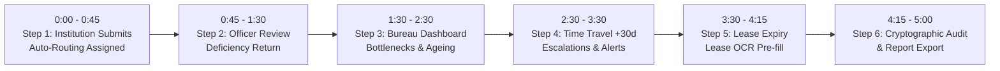

# ⏱️ IntelliApprove — 5-Minute Evaluator Live Demo Script
**Smart India Hackathon 2026 (Problem Statement 26262)**  
*AICTE Approval Process Automation, Compliance Monitoring & Vigilance Engine*

This script outlines a structured, timed 5-minute live demonstration designed specifically for SIH evaluators and judges. It guides evaluators through every statutory requirement—from multi-template application submission and deficiency return to simulated time-travel, multi-tier escalation, and cryptographic audit ledger verification.

---

## 🕒 Timing & Demonstration Sequence

---

## 🎬 Step-by-Step Walkthrough

### ⏱️ Minute 0:00 - 0:45 | Step 1: Institution Submits Application & Auto-Routing
**Goal**: Demonstrate applicant role scoping, dynamic route template assignment, and statutory SLA computation.

1. **Sign In**:
   - Navigate to `/login`.
   - Click the **Quick Demo Persona** dropdown and select `INSTITUTION: Delhi Institute of Technology & Mgmt` (`principal@ditm.ac.in` / `aicte123`).
   - Click **Sign In to Government Portal**.
2. **Submit New Application**:
   - Click **+ New Application** in the sidebar.
   - Enter Application Type: `New Technical Institution (Degree Engineering)`.
   - Select Academic Year: `2026-2027`.
   - Select Region: `North-West (Delhi / Haryana / Punjab)`.
   - Click **Submit Application**.
3. **Observe Automated Routing Engine (Section A)**:
   - Notice the system assigns the template: `Scrutiny + EVC + SAC/SHC` (Route #5) based on the new institution risk tier.
   - Initial stage is locked to `SCRUTINY` with statutory SLA: `15 Days`.
   - Note the **Explainable Delay Risk Score Badge** (calculated in real time via transparent weighted formula).

---

### ⏱️ Minute 0:45 - 1:30 | Step 2: Regional Officer Scrutiny & Mandatory Deficiency Return
**Goal**: Demonstrate statutory officer review, non-negotiable human oversight, and deficiency return with mandatory audit reason.

1. **Switch Persona to Regional Officer**:
   - In the top header bar, click the **Demo Persona Switcher** and select `REGIONAL_OFFICER: Er. Rajesh Sharma (NW Region)`.
2. **Open Application Queue**:
   - Navigate to `/applications`.
   - Filter by Status: `UNDER_SCRUTINY`.
   - Select the newly submitted application.
3. **Deficiency Return (Section A - Mandatory Reason Revert)**:
   - Click **Return for Clarification / Deficiencies**.
   - Attempt to click Submit without a reason -> Notice client-side validation prevents submission without mandatory statutory grounds.
   - Enter Reason:
     > *"Fire Safety NOC expired on 15-Oct-2026. Certified copy of building plan sanction from Municipal Corporation not attached."*
   - Click **Issue Official Deficiency Revert**.
4. **Verify State Transition**:
   - Application status updates to `RETURNED`.
   - System auto-generates the **Electronic Case Summary** marked *"Draft for Official Review"*.
   - A tamper-evident audit record is appended with the officer's digital identity and timestamp.

---

### ⏱️ Minute 1:30 - 2:30 | Step 3: Bureau National Dashboard (Ageing & Bottlenecks)
**Goal**: Demonstrate real-time Recharts dashboards, regional heatmaps, dwell-time bottleneck analysis, and SLA breach counters.

1. **Switch Persona to Bureau Officer**:
   - Click top bar Persona Switcher -> Select `BUREAU_OFFICER: Dr. Rajive Kumar (Member Secretary, HQ)` (`member.secretary@aicte.gov.in`).
2. **Explore National Vigilance Overview (Section B)**:
   - Look at the top KPI Cards: Total Active Cases, In-Progress, Returned, and statutory SLA Breach counters.
   - **Stage Funnel**: Interactive Recharts visualization tracking institutional progression from Scrutiny to Bureau Decision.
   - **Ageing Buckets**: Interactive bar chart displaying case pendency (0-7 days, 8-15 days, 16-30 days, 30+ days).
   - **Regional Pendency Heatmap**: Compare Northern vs. Western vs. North-Western processing times.
   - **Stage Bottlenecks Table**: Identifies exact stages with highest average dwell time (e.g. `EVC Field Inspection` averaging 14.2 days vs 10-day SLA).
3. **Click-Through Drilldown**:
   - Click on the `30+ Days` bar in the Ageing Chart -> Application list instantly filters to show high-risk overdue cases.

---

### ⏱️ Minute 2:30 - 3:30 | Step 4: Time Travel +30 Days & Automated Escalation Ladder
**Goal**: Demonstrate the simulated system clock, multi-tier escalation ladder (Level 1 -> Level 2 -> Level 3), and background rule evaluation.

1. **Trigger Time Travel**:
   - Notice the **Sim time** control widget and **Guided tour** button in the header at the top of the screen.
   - Click the button: **`Sim time`** (use the simulated clock widget in the header).
   - Notice the portal date advances by 30 days into the future (e.g. from October to November).
2. **Observe Real-Time Alerts & Escalation Ladder (Section F)**:
   - Notice the red **SLA Breach Counter** in the header and dashboard pulses and increments.
   - Open the **Notification Bell** (top right):
     - Unread count displays overdue notices and statutory alerts.
   - Navigate to `/alerts`:
     - **Level 1 Escalation**: Triggered at T+1 overdue -> Assigned Scrutiny Officer notified.
     - **Level 2 Escalation**: Triggered at T+7 overdue -> Regional Head notified.
     - **Level 3 Escalation**: Triggered at T+15 overdue -> Bureau Officer (HQ) notified.
   - Click on the **Escalation Ladder** tab to view the live status of escalated cases with audit log timestamps.

---

### ⏱️ Minute 3:30 - 4:15 | Step 5: Document Validity & Lease OCR Assist
**Goal**: Demonstrate color-coded document validity, expiry thresholds (90/60/30 days), and Lease OCR pre-filling.

1. **Navigate to Documents**:
   - Click **Documents** in the sidebar (`/documents`).
2. **Expiry Timeline Visualization (Section E)**:
   - View the color-coded expiry timeline:
     - 🟢 **Green** (`> 90 days`): Valid documents.
     - 🟡 **Amber** (`<= 60 days`): Approaching expiry alert.
     - 🔴 **Red** (`<= 30 days` or Expired): Critical validity breach requiring immediate undertaking or renewal.
3. **Lease OCR Assist (Differentiating Feature #3)**:
   - Click **Upload Renewal Document**.
   - Select Document Type: `Registered Land Lease Agreement`.
   - Click **Simulate Lease OCR Scan**:
     - System extracts the lease term and expiration date automatically.
     - Pre-fills the `Expiry Date` field.
     - Displays mandatory officer confirmation banner: *"AI Extracted: Officer must visually confirm against original document. System never auto-approves."*

---

### ⏱️ Minute 4:15 - 5:00 | Step 6: Cryptographic Audit Chain & Statutory Report Export
**Goal**: Demonstrate Rule #1 SHA-256 tamper-evident hash chaining, cryptographic chain integrity verification, and exportable reports.

1. **Navigate to Vigilance & Audit Explorer**:
   - Click **Audit Trail** in the sidebar (`/audit`).
2. **Rule #1 Cryptographic Verification**:
   - View the top security banner: **"Tamper-Evident SHA-256 Hash Chain: 100% Verified"**.
   - Note the **Genesis Anchor Hash** (`7c1c21e4...`) and latest **Head Block Hash**.
   - Click **Re-Verify Chain Now**:
     - Backend recomputes `SHA256(prev_hash + canonical_json(row))` across all ledger entries in `< 5 ms`.
     - Displays intact cryptographic integrity certificate.
3. **Generate Statutory Reports (Section G)**:
   - Click **Reports** in the sidebar (`/reports`).
   - Select Report Type: `1. Application Pendency by Stage & Ageing`.
   - Preview the live interactive chart and data table.
   - Click **Export to Excel / CSV**:
     - Browser downloads the certified report immediately.
     - Audit log registers the report export action with applicant ID and timestamp.

---

## 🏆 Summary of Evaluator Talking Points

- **Rule #1: Tamper-Evident Ledger**: Every action is cryptographically chained using SHA-256 with verifiable lineage.
- **Rule #2: Zero Autonomous Approvals**: System automates tracking and alerts, but all approvals and rejections require human authority decisions.
- **Rule #3: Dynamic Route Templates**: Workflow stages and SLAs are database-configured, supporting all 5 AICTE approval archetypes.
- **Rule #4: Statutory Timeframes**: Built-in 15/10/7 day SLA monitors with automated multi-tier escalation.
- **Rule #5: Strict RBAC Data Boundaries**: Zero cross-region or foreign institution data leaks.

